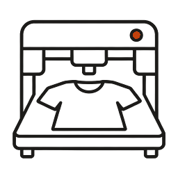
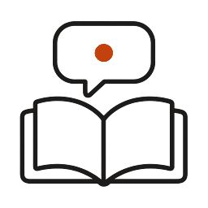
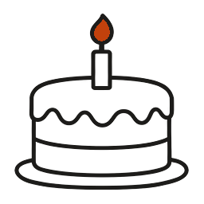
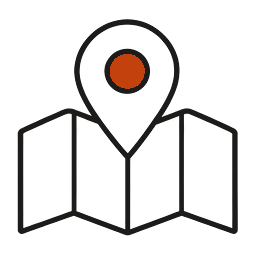

<picture><source media="(prefers-color-scheme: dark)" srcset="https://raw.githubusercontent.com/JivSTuban/JivSTuban/output/card-dark.svg"></picture>

<table>
<tr><td width="72" align="center"><picture><source media="(prefers-color-scheme: dark)" srcset="assets/icons/automation-dark.png"></picture></td><td>I build AI automation and full-stack products for US startups: workflow orchestration, RAG pipelines, and web apps tied to revenue. BS Information Technology, Cebu Institute of Technology University, graduated May 2026. Based in Cebu, Philippines, working remote.</td></tr>
<tr><td width="72" align="center"><picture><source media="(prefers-color-scheme: dark)" srcset="assets/icons/trophy-dark.png"></picture></td><td><b>GCash ImaGnation 2025:</b> 1st place out of 196 teams (980 students), with GAssure, a blockchain escrow on Solana.</td></tr>
</table>

<picture><source media="(prefers-color-scheme: dark)" srcset="https://raw.githubusercontent.com/JivSTuban/JivSTuban/output/route-dark.svg"></picture>

## Work

<table>
<tr><td width="72" align="center"><picture><source media="(prefers-color-scheme: dark)" srcset="assets/icons/medspa-dark.png"></picture></td><td><b>AI Engineer (project-based), <a href="https://traciety.com">Traciety</a></b>, Apr 2026 to now Image and video ad generation inside the production dashboard (HeyGen, Supabase), drawing on a 300+ ad library. Fixed Slack booking attribution from 54.3% to 97.0%. 166 merged pull requests (62% of the dashboard repo, Apr to Oct 2026). Owns tech ops for 40+ client sub-accounts and 18 n8n workflows.</td></tr>
<tr><td width="72" align="center"><picture><source media="(prefers-color-scheme: dark)" srcset="assets/icons/ferry-dark.png"></picture></td><td><b>Software Engineer Intern, Ayahay</b>, Nov 2025 to Mar 2026 Multi-tenant RAG chatbot rebuilt as NestJS microservices: about 40% lower latency, about 57% better retrieval recall.</td></tr>
<tr><td width="72" align="center"><picture><source media="(prefers-color-scheme: dark)" srcset="assets/icons/car-dark.png"></picture></td><td><b>Technical Lead, <a href="https://crowdsnare.com/">Crowdsnare AI</a></b>, Apr to Oct 2025 6 AI products across 10+ dealerships. Speed-to-lead agent: 11 vehicle sales, 90% booking conversion. n8n and GoHighLevel automation took manual hours to seconds.</td></tr>
<tr><td width="72" align="center"><picture><source media="(prefers-color-scheme: dark)" srcset="assets/icons/clapper-dark.png"></picture></td><td><b>AI Automation Developer, Cinematography for Actors Institute</b>, Jul 2025 to Jan 2026 Email automation on Google Cloud Run: 70% faster responses, grounded in 50+ SOPs. Ghost CMS mobile Lighthouse from 45 to 85+.</td></tr>
<tr><td width="72" align="center"><picture><source media="(prefers-color-scheme: dark)" srcset="assets/icons/print-dark.png"></picture></td><td><b>Full-stack Developer, Freckles Graphics</b>, Jul 2024 to Mar 2025 Print workflow for 500+ daily orders, 85% less manual processing, at a company running $12M+ a year. Image studio with sub-30-second generation.</td></tr>
</table>

## Stack

<picture><source media="(prefers-color-scheme: dark)" srcset="https://raw.githubusercontent.com/JivSTuban/JivSTuban/output/stack-dark.svg"></picture>

The stack as text

| Layer | Tools |
|:--|:--|
| AI | Claude Code, Codex CLI, MCP, OpenAI API, RAG, n8n, Playwright, Vapi, ElevenLabs |
| Backend | Node.js, NestJS, Spring Boot, FastAPI, Django, Flask, Laravel, ASP.NET Core |
| Frontend and mobile | Next.js, React, TypeScript, Tailwind CSS, Flutter, Dart, Angular, Vue.js |
| Cloud and data | Google Cloud Run, Pub/Sub, AWS, DigitalOcean, Docker, Supabase, PostgreSQL, MySQL |

**Certifications:** Anthropic Academy (18 certificates, Jun 2026), AWS Academy Cloud Architecting and Cloud Foundations, Udemy Python and Django, .NET 8 Web API, PHP, Angular.

## Projects

<table>
<tr><td width="72" align="center"><picture><source media="(prefers-color-scheme: dark)" srcset="assets/icons/autoapply-dark.png"></picture></td><td><b>AutoApply</b>: multi-tenant job application engine used by 11 people. Parses resumes, scores fit with chained AI models, submits through Playwright and ATS integrations. 377 passing tests. Node.js, Playwright, Supabase, React, TypeScript, OpenAI</td></tr>
<tr><td width="72" align="center"><picture><source media="(prefers-color-scheme: dark)" srcset="assets/icons/privacy-dark.png"></picture></td><td><b>weewoo</b>: end-to-end encrypted location sharing and chat. The server stores only ciphertext; 36 row-level-security policies; 223 passing tests. Flutter, Dart, Supabase, libsodium, Argon2id</td></tr>
<tr><td width="72" align="center"><picture><source media="(prefers-color-scheme: dark)" srcset="assets/icons/sdk-dark.png"></picture></td><td><b><a href="https://github.com/JivSTuban/knowledge-base-sdk">Knowledge Base SDK</a></b>: open-source TypeScript SDK for ingestion, vector search and streaming answers, with a whitelabel React chat widget, powering Ayahay. TypeScript, React, pgvector, Vercel AI SDK</td></tr>
<tr><td width="72" align="center"><picture><source media="(prefers-color-scheme: dark)" srcset="assets/icons/house-dark.png"></picture></td><td><b><a href="https://austinmcclain.com">Austin McClain</a></b>: real estate portfolio. Automated MLS feeds process 119+ listings worth $13.5M. React, Supabase, Cloudinary</td></tr>
<tr><td width="72" align="center"><picture><source media="(prefers-color-scheme: dark)" srcset="assets/icons/cake-dark.png"></picture></td><td><b><a href="https://keilahs.shop">Keilah's Cakes</a></b>: bakery storefront with a 95+ Lighthouse score and an optimized image pipeline. Next.js, Supabase, Tailwind</td></tr>
<tr><td width="72" align="center"><picture><source media="(prefers-color-scheme: dark)" srcset="assets/icons/internship-dark.png"></picture></td><td><b>OJTech</b>: internship matching with NLP-based job recommendations. React, Spring Boot, Gemini API</td></tr>
<tr><td width="72" align="center"><picture><source media="(prefers-color-scheme: dark)" srcset="assets/icons/map-dark.png"></picture></td><td><b>Navigram</b>: social memory sharing with geospatial indexing and real-time chat. Spring Boot, React, Kotlin, WebSockets</td></tr>
<tr><td width="72" align="center"><picture><source media="(prefers-color-scheme: dark)" srcset="assets/icons/escrow-dark.png"></picture></td><td><b>GAssure</b>: escrow that blocks middle-man scams. 1st place, GCash ImaGnation 2025. React, Supabase, Solana</td></tr>
</table>

<picture><source media="(prefers-color-scheme: dark)" srcset="https://raw.githubusercontent.com/JivSTuban/JivSTuban/output/route-dark.svg"></picture>

## Contact

<a href="https://farfolio.vercel.app"><picture><source media="(prefers-color-scheme: dark)" srcset="https://raw.githubusercontent.com/JivSTuban/JivSTuban/output/chip-portfolio-dark.svg"></picture></a> <a href="https://linkedin.com/in/jiv-tuban"><picture><source media="(prefers-color-scheme: dark)" srcset="https://raw.githubusercontent.com/JivSTuban/JivSTuban/output/chip-linkedin-dark.svg"></picture></a> <a href="mailto:jivtuban14@gmail.com"><picture><source media="(prefers-color-scheme: dark)" srcset="https://raw.githubusercontent.com/JivSTuban/JivSTuban/output/chip-email-dark.svg"></picture></a> <a href="Tuban_CV.pdf"><picture><source media="(prefers-color-scheme: dark)" srcset="https://raw.githubusercontent.com/JivSTuban/JivSTuban/output/chip-cv-dark.svg"></picture></a>
