<picture><source media="(prefers-color-scheme: dark)" srcset="https://raw.githubusercontent.com/JivSTuban/JivSTuban/output/typing-dark.svg"></picture>

<picture><source media="(prefers-color-scheme: dark)" srcset="https://raw.githubusercontent.com/JivSTuban/JivSTuban/output/fetch-dark.svg"></picture>

<picture><source media="(prefers-color-scheme: dark)" srcset="https://raw.githubusercontent.com/JivSTuban/JivSTuban/output/city-dark.svg">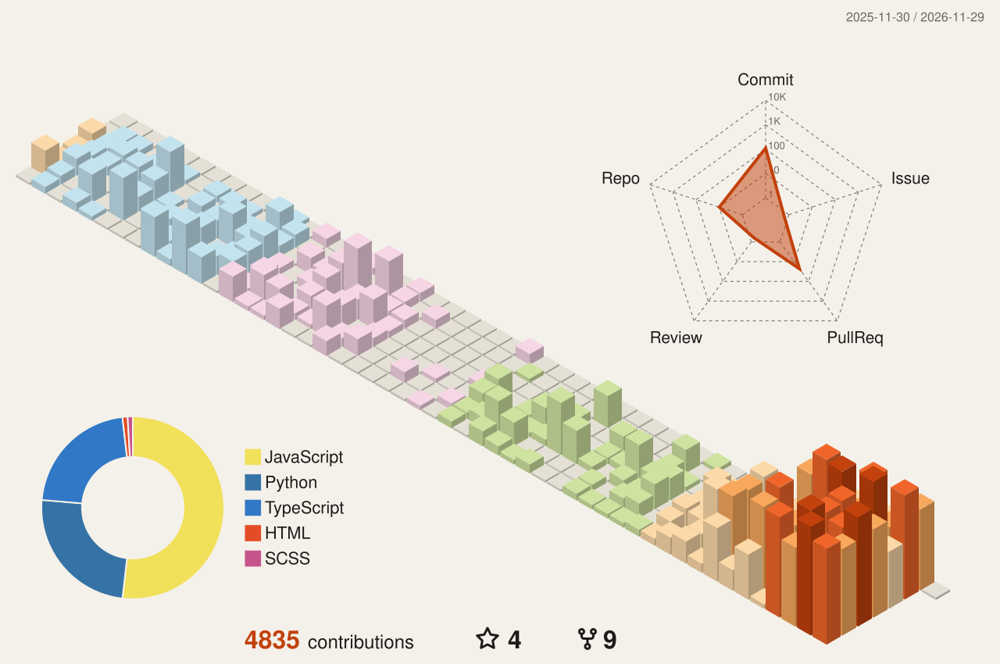</picture>

## Work

<a href="https://traciety.com"><picture><source media="(prefers-color-scheme: dark)" srcset="https://raw.githubusercontent.com/JivSTuban/JivSTuban/output/work-traciety-dark.svg">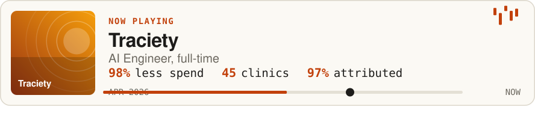</picture></a>
<picture><source media="(prefers-color-scheme: dark)" srcset="https://raw.githubusercontent.com/JivSTuban/JivSTuban/output/work-ayahay-dark.svg">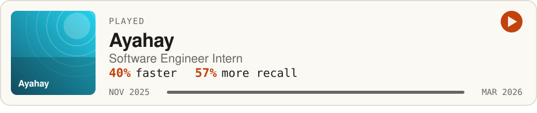</picture>
<a href="https://crowdsnare.com/"><picture><source media="(prefers-color-scheme: dark)" srcset="https://raw.githubusercontent.com/JivSTuban/JivSTuban/output/work-crowdsnare-dark.svg">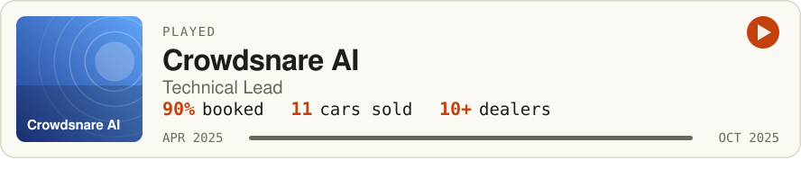</picture></a>
<picture><source media="(prefers-color-scheme: dark)" srcset="https://raw.githubusercontent.com/JivSTuban/JivSTuban/output/work-cfai-dark.svg">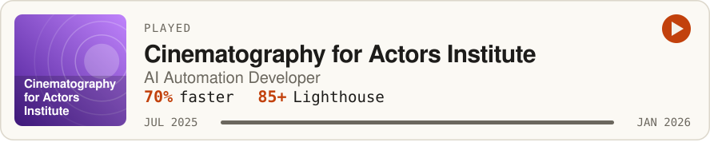</picture>
<picture><source media="(prefers-color-scheme: dark)" srcset="https://raw.githubusercontent.com/JivSTuban/JivSTuban/output/work-freckles-dark.svg">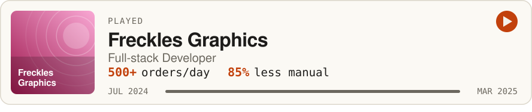</picture>

## Stack

<picture><source media="(prefers-color-scheme: dark)" srcset="https://raw.githubusercontent.com/JivSTuban/JivSTuban/output/stack-dark.svg"></picture>

<picture><source media="(prefers-color-scheme: dark)" srcset="https://raw.githubusercontent.com/JivSTuban/JivSTuban/output/certs-dark.svg"></picture>

## Projects

<picture><source media="(prefers-color-scheme: dark)" srcset="https://raw.githubusercontent.com/JivSTuban/JivSTuban/output/projects-dark.svg"></picture>

## Contact

<a href="https://farfolio.vercel.app"><picture><source media="(prefers-color-scheme: dark)" srcset="https://raw.githubusercontent.com/JivSTuban/JivSTuban/output/chip-portfolio-dark.svg"></picture></a> <a href="https://linkedin.com/in/jiv-tuban"><picture><source media="(prefers-color-scheme: dark)" srcset="https://raw.githubusercontent.com/JivSTuban/JivSTuban/output/chip-linkedin-dark.svg"></picture></a> <a href="mailto:jivtuban14@gmail.com"><picture><source media="(prefers-color-scheme: dark)" srcset="https://raw.githubusercontent.com/JivSTuban/JivSTuban/output/chip-email-dark.svg"></picture></a> <a href="Tuban_CV.pdf"><picture><source media="(prefers-color-scheme: dark)" srcset="https://raw.githubusercontent.com/JivSTuban/JivSTuban/output/chip-cv-dark.svg"></picture></a>
